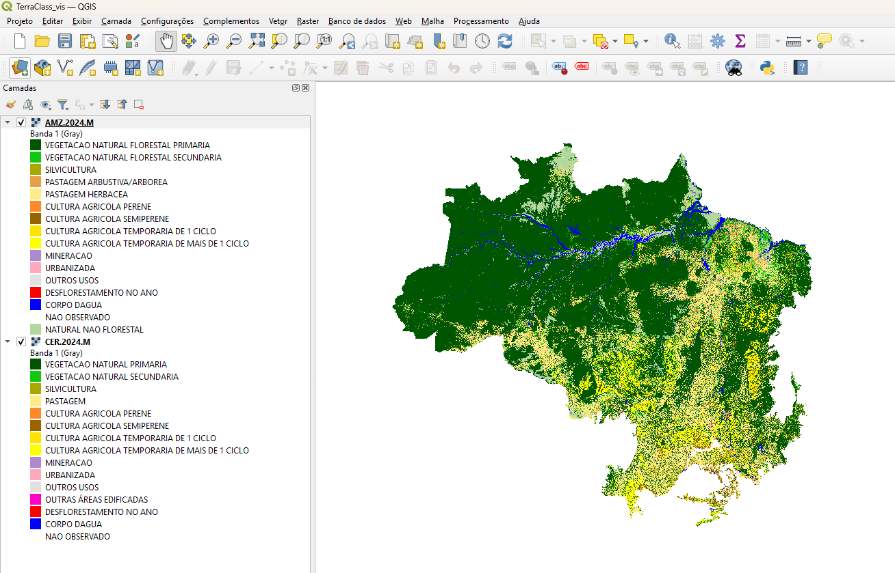

```{r setup, include=FALSE}
knitr::opts_chunk$set(echo = TRUE)
```

## Introduction

In this workflow, I import the latest available land use and cover maps from TerraClass Cerrado and Amazonia (2024) for data exploration and to mosaic them into a single map with a unified classification and simbology. Most of the workflow relies on the package Terra.
Detailed documentation on TerraClass methodology can be found at http://marte2.sid.inpe.br/ibi/8JMKD3MGP6W34M/4AH5NEL (internal to INPE) and at https://www.mdpi.com/2220-9964/8/11/513#TerraBrasilis_A_Spatial_Data_Analytics%C2%A0Infrastructure_a5 (open-access paper).

```{r Packages}
# load required packages --------------
library(terra)
library(here)
library(tidyverse)
```


## Data Import 
In this section, we import TerraClass thematic maps on Land Use and Cover (LUC) for the Brazilian Amazon and Cerrado biomes.
Data was obtained from https://www.terraclass.gov.br/download-de-dados and stored in a specific directory.
Using the package and function *here*, we inform the system the location of the folder.

```{r Set_Directory}
# define Terraclass data directory
## arguments in the function "here" must be replaced with the local directory path where Terraclass data is stored
terraclass_dir <- here::here("data","raw","terraclass")
```

Then, load the files with the LUC maps, using the Terraclass directory path informed.

```{r Load_files}
Am24 <- terra::rast(file.path(terraclass_dir,"AMZ.2024.M","biomas_classificados","AMZ.2024.M.tif"))
Ce24 <- terra::rast(file.path(terraclass_dir,"CER.2024.M","CER.2024.M.tif"))
```

## Data exploration

After import, we inspect the objects with the loaded maps to ensure they have loaded properly and compare them to check if the spatial attributes will not conflict during the mosaic processing.

```{r Inspection}
# Inspect objects attributes
Am24
Ce24
describe(Ce24)
describe(Am24)
```

Both objects appropriately show as SpatRaster, with GEOCRS Sirgas 2000 EPSG 4674, pixel size 0.00009 degrees.
They show different points of origin and extents, which is expected given they cover different areas. Minimum and maximum values are also different: 1 to 51 for the Amazon and 1 to 23 for Cerrado. That alerts to class differences.

```{r Comparison}
# compare geometries
compareGeom(Am24,Ce24,
            stopOnError = FALSE,
            messages = TRUE) #ok, extents do not match, so further inspection is needed

ext(Am24)
ext(Ce24) #different

res(Am24)
res(Ce24) #same

crs(Am24)
crs(Ce24) #same

dim(Am24)
dim(Ce24) #different

origin(Am24)
origin(Ce24) #same
```

Different extent and dimension are expected and will not preclude mosaicing.

```{r Maps}
# view maps
plot(Ce24)
plot(Am24)
```

These simple plots shown the classes as a continuous gradient. Knowledge of the region allows us to infer the lowest value classes refer to natural vegetation. to further inspect the classes, check the values present and their frequency.


```{r Class Frequency}
# check frequency of values (classes) in each raster
freq_am <- terra::freq(Am24)
freq_ce <- terra::freq(Ce24)
print(freq_am)
print(freq_ce)

# compare Cerrado and Amazonia classes
## Extract class codes
classes_am <- freq_am$value
classes_ce <- freq_ce$value

## Compare class codes
class_comparison <- data.frame(
  class_code = sort(union(classes_am, classes_ce))
)

class_comparison$Amazonia <- 
  class_comparison$class_code %in% classes_am

class_comparison$Cerrado <- 
  class_comparison$class_code %in% classes_ce

print(class_comparison)
```

Classes 10, 25 and 51 are exclusive to the Amazon layer; Class 21 is exclusive of the Cerrado layer.
The raster files downloaded from the TerraClass page were accompanied by a QGIS symbology layer (*.qml). Hence, opening the rasters and respective symbologies in QGIs alloes close inspection of the classes. Classes should be interpreted with the support of the class description available for the Amazon and Cerrado, available at https://www.terraclass.gov.br/classes?bioma=amazonia and https://www.terraclass.gov.br/classes?bioma=cerrado, respectively.


```{r, echo=FALSE, out.width="60%", fig.align="center"}

```

Three important distinctions are clarified:
- while classes 1 and 2 in both layers refer to primary and secondary vegetation, they refer to Amazon and Cerrado vegetations in their respective layers.
- In the Amazon layer, Pasture is classified as either Vegetated or herbaceous, while for the Cerrado layer there is only one Pastureland class.
- In the Amazon layer, there is the additional class 51, that refers to Non-forest natural formations. It is possible that some of the area identified in this class is actually Cerrado vegetation; however, no information was found in the before-mentioned sources to corroborate that.
Hence, there needs to be a reclassification before the mosaic to ensure those classes are differentiated in the final product.

To better work with the classes without consulting QGIS, the following code assigns the class names to the numbers.

```{r Name_classes}
# create tables with class names/descriptions
 

classes_am <- data.frame(
  source_lyr = "am24",
  class_code = sort(classes_am),
  class_name = c("Primary Amazon Vegetation", "Secondary Amazon Vegetation", "Silviculture", "Vegetated pasture", "Herbaceous pasture",
                 "Perennial Agriculture", "Semi-perennial agriculture", "Single cycle agriculture", "Multiple cycles agriculture",
                  "Mining", "Urban", "Other uses", "Deforestation for the year", 
                 "Water bodies", "Not observed", "Non-forest natural formations"))

classes_ce <- data.frame(
  source_lyr = "ce24",
  class_code = sort(classes_ce),
  class_name = c("Primary Cerrado Vegetation", "Secondary Cerrado Vegetation", "Silviculture", "Pasture - generic",
                 "Perennial Agriculture", "Semi-perennial agriculture", "Single cycle agriculture", "Multiple cycles agriculture",
                 "Mining", "Urban", "Other uses", "Other built areas", "Deforestation for the year",
                 "Water bodies"))

```


## Reclassification

In this section, new classes are created to ensure all information from the individual layers is preserved in the mosaic.

```{r Reclass}
# reclass Cerrado layer to assign codes not repeated in Amazon and avoid mislabeling in mosaic
new_classes <- data.frame(from = c(1,2,11),
                          to = c(1,2,11),
                          becomes = c(26,27,28)) # 26 = Primary Cerrado; 27 = Secondary Cerrado, 28 = Pasture - generic
Ce24.rcl <- classify(Ce24, rcl=as.matrix(new_classes), right = NA)
print(freq(Ce24.rcl))

```

## Mosaic

Finally, a new layer with both the Cerrado and Amazon data is created and plotted.

```{r Mosaic}
# check correspondences before mosaic ---------------
terra::origin(Am24)
terra::origin(Ce24)

# mosaic
AmCe24 <- mosaic(Am24,Ce24.rcl, fun="max")
plot(AmCe24)
```

## Visualization

Creates a thematic map visualization with chosen colors and a legend box.
The first step is creating and assigning the class names to the mosaic raster, as well as the order we wish the legend to follow.

```{r Plot, fig.width=12, fig.height=8, dpi=300}
source(here::here("scripts", "Map_plot.R"))
```
